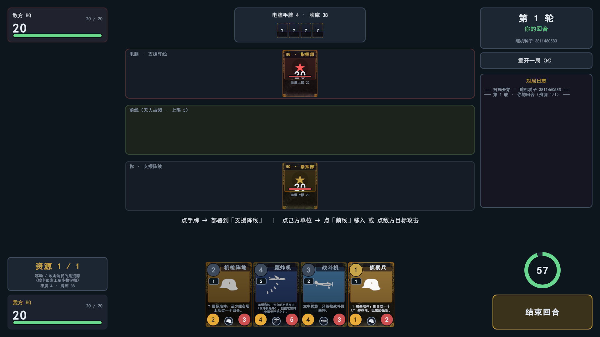
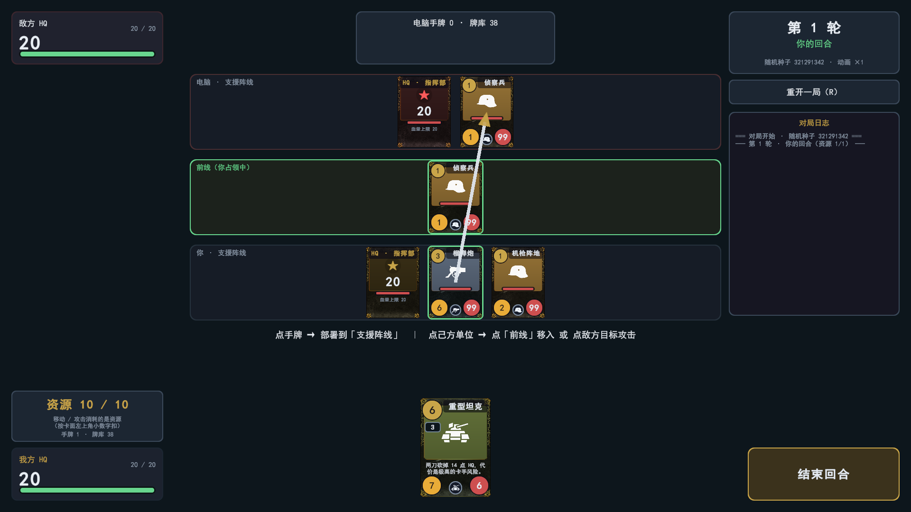
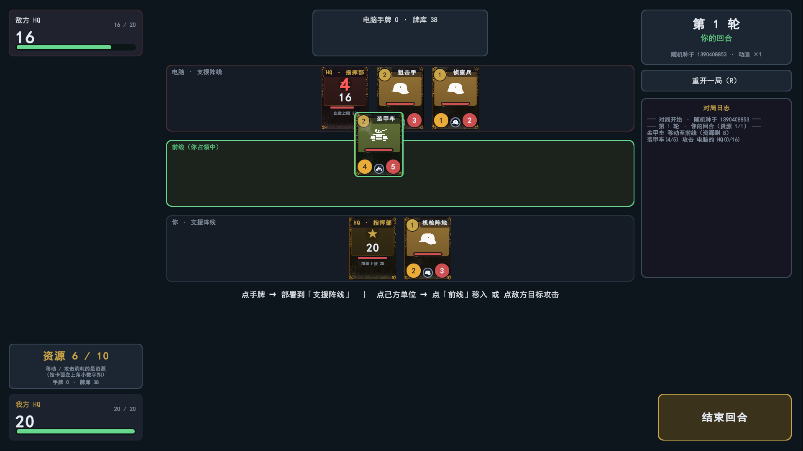
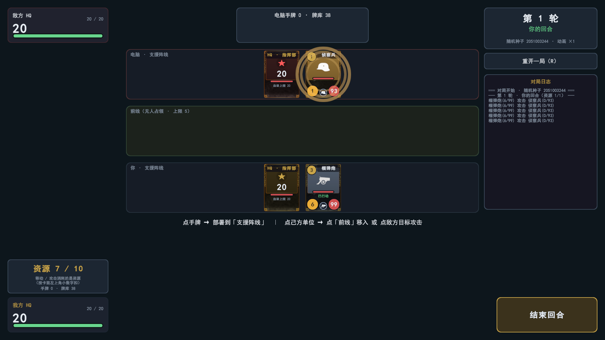

# KardsLike

**一个参考《Kards》的二战题材集换式卡牌游戏，从零手写的 Unity 工程。**

> 非官方、非商业的个人学习项目，与 Kards 官方无关。

三条战线、五种兵种、关键字词条、确定性随机 —— 规则引擎与表现层彻底分离：同一份 `Core` 代码
既驱动可玩的对局 UI，也驱动无 UI 的 200 局批量平衡性模拟。

<p align="center">
  
</p>

## 玩法要点

| 系统 | 规则 |
|---|---|
| 战场 | 三条战线：敌方支援阵线 / 共享前线 / 我方支援阵线，每条 5 格（含 HQ） |
| HQ | 20 点生命，占支援阵线 1 格，可被攻击 |
| 资源 | 每回合增长、上限 10；卡牌费用 1~6，行动费按费用分档（1~3） |
| 牌库 | 14 种卡牌 × 3 份 = 42 张；起手 4 张；抽空后转为疲劳伤害（2^k） |
| 回合 | 60 秒倒计时，归零自动结束回合 |
| 兵种 | 步兵、坦克：攻击相邻战线；火炮、战斗机、轰炸机：可越线攻击任意战线与 HQ |
| 反击 | 火炮不受反击；轰炸机既不承受也不造成反击（被战斗机攻击时例外） |
| 拦截 | 战斗机可拦截同战线上的敌方轰炸机，轰炸机须先击落拦截者 |
| 行动 | 部署失调（登场当回合不能行动）+ 每回合一次行动（移动 **或** 攻击）；**坦克例外**：可同回合移动 + 攻击，两次各付一次行动费 |
| 关键字 | 已实现：闪击 / 重甲(X) / 冲击；规划中：烟幕 / 守护 / 伏击 / 奋战 |
| AI | 贪心 AI，单步枚举（UI 分步播放）与整轮推演（批量模拟）共用同一份逻辑 |
| 确定性 | 自实现 mulberry32 随机数；同种子对局逐字段可复现，便于回归对比 |

## 截图

**选中目标时，箭头从卡面伸出指向鼠标所指单位，双方卡面同时浮现结算后的生命值：**

<p align="center">
  
</p>

**坦克是唯一能在同一回合内「移动 + 攻击」的兵种**（右侧日志记录两次行动，各扣一次行动费）：

<p align="center">
  
</p>

**远程兵种可越线打击，命中时有按兵种分化的特效：**

<p align="center">
  
</p>

## 快速开始

1. 用 Unity Hub 打开本工程，编辑器版本 **Unity 2022.3.62f3c1 LTS**（URP 2D 模板）
2. 打开场景 `Assets/Scenes/SampleScene.unity`
3. 点击 Play
4. 菜单栏 `KardsLike → 自检` 可运行 **12 项**自动检查（含同种子复现、200 局先手偏差统计、各规则断言）

## 工程结构

```
Assets/KardsLike/
├── Scripts/
│   ├── Core/                纯 C# 规则引擎（零 UnityEngine 依赖，asmdef 锁定）
│   │   ├── GameEngine.cs    引擎主循环
│   │   ├── GameEngine.Turn.cs    回合与资源
│   │   ├── GameEngine.Play.cs    出牌与部署
│   │   ├── GameEngine.Combat.cs  结算（射程 / 反击 / 拦截 / 关键字）
│   │   ├── CardDb.cs        卡池数值唯一来源（14 张卡）
│   │   ├── GreedyAI.cs      贪心 AI
│   │   └── Rng.cs           mulberry32 确定性随机
│   └── View/                uGUI 表现层（只读 Core，绝不回写）
├── Editor/                  自检工具（12 项）
├── Art/                     卡框与五兵种图标（来源见 CREDITS.txt）
├── Fonts/                   中文 TMP 字体
└── Resources/               资源引用表（CardArt.asset）
Docs/                        设计文档、阶段报告、规则核对 —— 规则真相来源
Screenshots/                 开发过程截图
```

## 当前进度

**阶段 2.6 · 词条体系与表现层收口**（任务 0~4 已完成，任务 5 准备中）

- 已完成：卡牌与兵种系统、三条战线、HQ 与疲劳、部署失调、每回合一次行动
- 已完成：五种兵种 + 反击例外 + 越线射程 + 战斗机拦截轰炸机
- 已完成：坦克「移动 + 攻击」
- 已完成：关键字第一批 —— 闪击 / 重甲(X) / 冲击，6 张卡挂载面板折让
- 已完成：卡面 UI、选中箭头 + 伤害预览、按兵种分化的攻击特效、指令卡打出动画
- 进行中：关键字第二批 —— 烟幕 / 守护 / 伏击
- 未开始：关键字第三批 —— 奋战 + 面板重新定价

详细状态见 [`Docs/PROJECT_STATE.md`](Docs/PROJECT_STATE.md)，完整规则见 [`Docs/阶段0-设计文档.md`](Docs/阶段0-设计文档.md)。

## 素材与许可

| 资源 | 来源 | 许可 |
|---|---|---|
| 兵种图标（5 个） | [game-icons.net](https://game-icons.net/) | **CC BY 3.0**（需署名，已登记于 `Assets/KardsLike/Art/CREDITS.txt`） |
| 卡面框架 | [OpenGameArt — Card Template](https://opengameart.org/content/card-template-1)，作者 Cethiel | CC0（免署名） |
| 中文字体 `SimHei.ttf` | 微软系统字体 | **有版权，仅限本机私有环境使用**；公开分发前须替换为开源字体（如 Noto Sans SC） |

## 说明

- 本项目为个人学习/研究性质，用于练习卡牌游戏的规则系统、AI 与表现层工程化
- 与 Kards 官方无任何关联；相关名词仅用于说明规则参考来源
- 素材来源登记见 `Assets/KardsLike/Art/CREDITS.txt`
